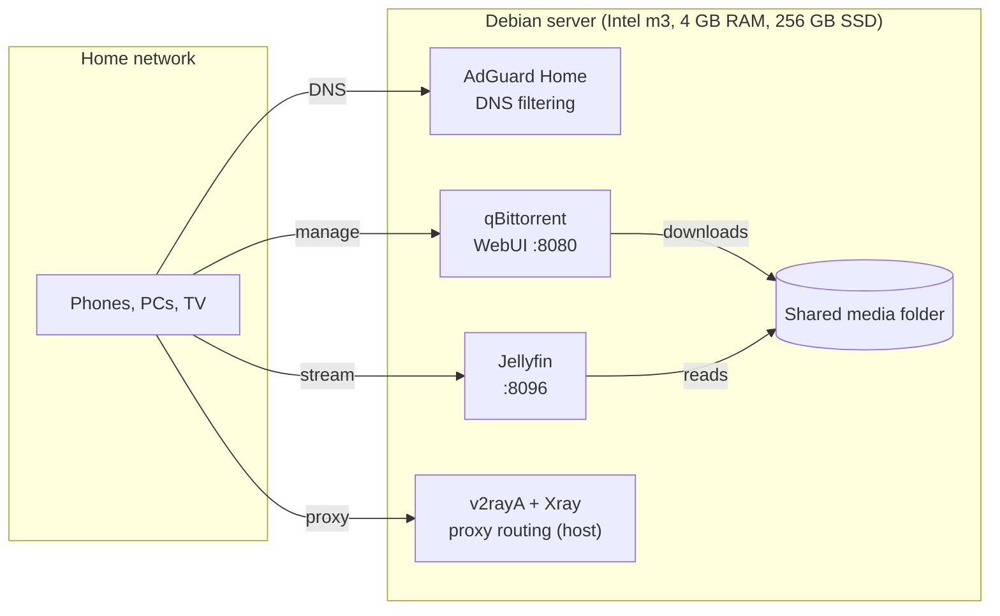

# Home Server on an Old Laptop

**English** · [Русский](README.ru.md)

> A silent, fanless Debian server built from a laptop with a dead battery: DNS-level ad blocking, a media library and a download client, all in Docker Compose on 4 GB of RAM.

📺 **Video walkthrough:** [English](https://youtu.be/I3JlJ0OKSJ8) · [Русский (ENG sub)](https://youtu.be/SwqW1GDu1iw)
💼 **Write-ups:** [LinkedIn](https://www.linkedin.com/in/aloncie/)

## What's inside

| Service | Folder | Image / source | Ports | What it does |
| --- | --- | --- | --- | --- |
| AdGuard Home | `net/` | `adguard/adguardhome` | host network (DNS 53; setup wizard on 3000) | DNS filtering, tracker and ad blocking, query log for the whole LAN |
| Jellyfin | `jellyfin/` | `lscr.io/linuxserver/jellyfin` | 8096 | Media server with hardware transcoding through `/dev/dri` |
| qBittorrent | `qbittorrent/` | `lscr.io/linuxserver/qbittorrent` | 8080 (WebUI, LAN only) + a torrent port from `.env` | Download client that writes into the shared media folder |
| v2rayA + Xray | `setup.sh` | apt packages | web UI (default 2017) | Proxy routing for devices on the local network, runs on the host, not in Docker |

## Hardware

| Part | Spec |
| --- | --- |
| Machine | Xiaomi Mi Notebook Air 12.5" (dead battery, fanless) |
| CPU | Intel Core m3-7Y30 |
| RAM | 4 GB |
| Storage | 256 GB SATA SSD |
| OS | Debian 13, headless (no desktop environment) |

## Architecture



## Repository layout

```text
.
├── setup.sh                  # base provisioning: updates, kernel tuning, Docker, v2rayA + Xray
├── net/
│   └── docker-compose.yml    # AdGuard Home (host network)
├── jellyfin/
│   └── docker-compose.yml    # Jellyfin with /dev/dri passthrough
├── qbittorrent/
│   ├── docker-compose.yml    # qBittorrent
│   └── .env.example          # torrent port template
└── .gitignore                # keeps configs, databases, logs and .env out of git
```

## Quick start

1. **Install Debian** (headless is fine) and enable SSH.
2. **Clone the repo** and run the base setup:

   ```bash
   git clone https://github.com/Aloncie/Server.git
   cd Server
   chmod +x setup.sh && ./setup.sh
   ```

   The script updates the system, optionally installs Zsh, Neovim, tmux and htop, enables BBR and IP forwarding, installs Docker Engine with the Compose plugin from the official repository, and installs and enables v2rayA with Xray. Log out and back in afterwards so the new Docker group applies.
3. **Adjust the paths** for your machine (see the notes below).
4. **Start the stacks**, DNS first:

   ```bash
   cd net && docker compose up -d && cd ..
   cd jellyfin && docker compose up -d && cd ..
   cd qbittorrent && cp .env.example .env   # set TORRENT_INPUT_PORT first
   docker compose up -d
   ```
5. **First run:** open AdGuard Home on port 3000 to finish its setup, then point your router's DNS to the server. Jellyfin has its own wizard on 8096. The qBittorrent WebUI prints a temporary password in `docker logs qbittorrent`.

## Configuration notes

- **Media folder:** the compose files mount `/home/aloncie-server/media`. Change it to your own path in `jellyfin/docker-compose.yml` and `qbittorrent/docker-compose.yml`.
- **GPU transcoding:** Jellyfin uses `/dev/dri` and the `render` group (GID `992` here). Check yours with `getent group render`.
- **qBittorrent WebUI** is published on a LAN address (`192.168.3.13:8080`). Replace it with the IP of your server.
- **Time zone** is set to `Europe/Moscow` in every compose file.
- **Secrets stay local.** `.gitignore` excludes AdGuard, Jellyfin and qBittorrent configs, databases, logs and `.env` files. Only `.env.example` is committed.

## What a 4 GB fanless laptop teaches you

- **RAM is the ceiling.** With several containers on 4 GB, watch the idle footprint, otherwise the Linux OOM killer decides for you.
- **Laptops hate being headless.** Make the lid, the firewall and the battery behave like a server: see [Hardening the server](#hardening-the-server).
- **Passive cooling has limits.** Long I/O load means thermal throttling, so keep an eye on the CPU governor and temperatures.

## Hardening the server

A server that stays on 24/7 should expose as little as possible. Three things matter most on a laptop: the firewall, the lid and the battery.

### Firewall: close every port you do not use

Default policy is "deny everything incoming", then open only what the services above need, and only for the local network. Every open port is a door someone can try, and a closed one cannot be attacked at all.

| Port | Service | Why it is open | Who should reach it |
| --- | --- | --- | --- |
| 22/tcp | SSH | Remote administration of a headless machine | LAN only (key-based login, no root, no passwords) |
| 53/tcp+udp | AdGuard Home | DNS for the whole network, the reason the server exists | LAN only |
| 3000/tcp | AdGuard Home | First-run setup wizard | Open only during setup, then close it |
| 80/tcp | AdGuard Home | Its web UI after the wizard is finished | LAN only |
| 8096/tcp | Jellyfin | Streaming to TV, phones and PCs | LAN only |
| 8080/tcp | qBittorrent | WebUI | LAN only |
| torrent port (from `.env`) | qBittorrent | Incoming peers; without it downloads are slower | The only port you may forward on the router, and only if you want it |
| 2017/tcp | v2rayA | Its web UI | LAN only |
| 20170-20172/tcp | v2rayA | Default proxy ports for LAN devices | LAN only, and only if other devices use the proxy |

Everything else stays closed. Ports 3000 and 80 depend on how you finished the AdGuard wizard, so check what is really listening first with `sudo ss -tulpn` and adjust the table to your setup.

```bash
sudo apt install ufw
sudo ufw default deny incoming
sudo ufw default allow outgoing

# replace the subnet with your own
sudo ufw allow from 192.168.3.0/24 to any port 22 proto tcp
sudo ufw allow from 192.168.3.0/24 to any port 53
sudo ufw allow from 192.168.3.0/24 to any port 80 proto tcp
sudo ufw allow from 192.168.3.0/24 to any port 8096 proto tcp
sudo ufw allow from 192.168.3.0/24 to any port 8080 proto tcp
sudo ufw allow from 192.168.3.0/24 to any port 2017 proto tcp

sudo ufw enable
sudo ufw status numbered
```

Two things to know:

- **Docker bypasses ufw.** Docker writes its own iptables rules, so a port published with `ports:` can be reachable even when ufw says it is closed. That is why qBittorrent is published on the LAN address only. For Jellyfin either bind the port to the LAN IP too (`192.168.3.13:8096:8096`) or filter in the `DOCKER-USER` chain. AdGuard uses the host network, so ufw applies to it normally.
- **Do not forward ports on the router** except, optionally, the torrent port. For remote access use a VPN instead of opening the WebUIs to the internet.

Also harden SSH in `/etc/ssh/sshd_config`: `PasswordAuthentication no`, `PermitRootLogin no`, then `sudo systemctl reload ssh`. Copy your key first with `ssh-copy-id`.

### Keep the server running with the lid closed

By default systemd-logind suspends a laptop when the lid closes, which turns a server into a brick. Edit `/etc/systemd/logind.conf`:

```ini
HandleLidSwitch=ignore
HandleLidSwitchExternalPower=ignore
HandleLidSwitchDocked=ignore
```

Then reboot (or run `sudo systemctl restart systemd-logind`, which may end your SSH session). The screen can stay off: a headless Debian does not need it.

### Battery care

The server in the video runs without a working battery, but if yours has one, a laptop that sits on a charger at 100% all year wears the battery out fast and a swollen cell is a fire risk. Keep the charge between roughly 20% and 80%:

- Many laptops expose a limit in the firmware or BIOS ("battery care", "conservation mode").
- On Linux, check `ls /sys/class/power_supply/BAT0/` for `charge_control_end_threshold`. If it exists, write `80` to it (persist it with a systemd unit or TLP).
- With TLP (ThinkPads and a few other models): set `START_CHARGE_THRESH_BAT0=20` and `STOP_CHARGE_THRESH_BAT0=80` in `/etc/tlp.conf`.

Support depends on the vendor. If none of these exist on your model, the safest option for a permanently plugged-in server is to remove a dead or swollen battery altogether and run on mains power, as this project does.

## Security and legal notes

- Keep the WebUIs on the LAN and the firewall closed by default (see above). Do not expose AdGuard, Jellyfin or qBittorrent to the internet without a reverse proxy and authentication.
- Containers run as a regular user (`PUID/PGID 1000`) where the image supports it.
- Use qBittorrent only for content you have the right to share, for example Linux ISOs and open media.

## Author

**Bogdan Bakuta (Aloncie)** · Systems software engineer · [GitHub](https://github.com/Aloncie) · [LinkedIn](https://www.linkedin.com/in/aloncie/) · [Telegram](https://t.me/Aloncie)
