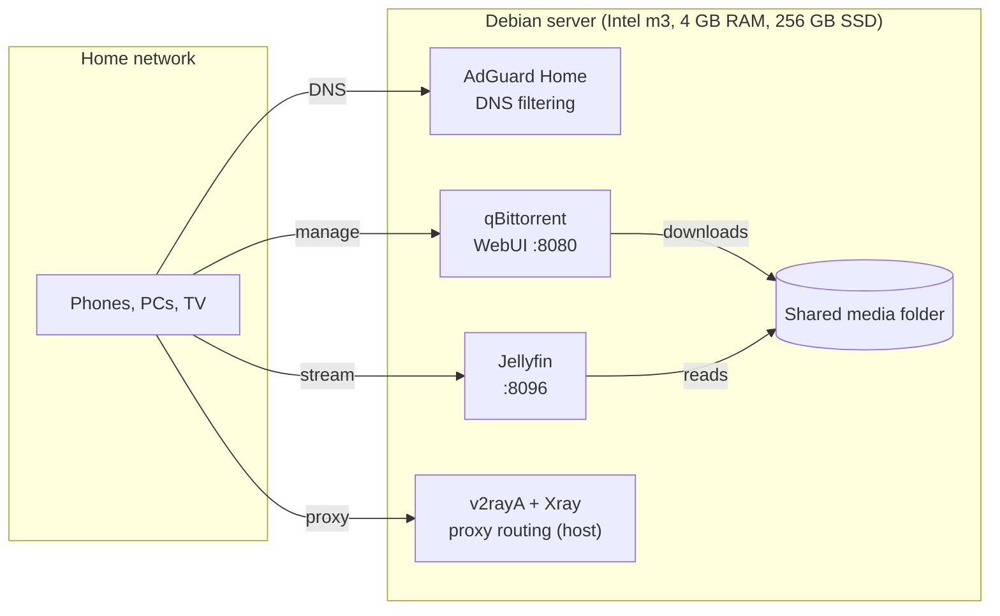

# Home Server on an Old Laptop

> A silent, fanless Debian server built from a laptop with a dead battery: DNS-level ad blocking, a media library and a download client, all in Docker Compose on 4 GB of RAM.

📺 **Video walkthrough:** [English](https://youtu.be/I3JlJ0OKSJ8) · [Русский (ENG sub)](https://youtu.be/SwqW1GDu1iw)
💼 **Write-ups:** [LinkedIn](https://www.linkedin.com/in/aloncie/)

## What's inside

| Service | Folder | Image / source | Ports | What it does |
| --- | --- | --- | --- | --- |
| AdGuard Home | `net/` | `adguard/adguardhome` | host network (DNS 53; setup wizard on 3000) | DNS filtering, tracker and ad blocking, query log for the whole LAN |
| Jellyfin | `jellyfin/` | `lscr.io/linuxserver/jellyfin` | 8096 | Media server with hardware transcoding through `/dev/dri` |
| qBittorrent | `qbittorrent/` | `lscr.io/linuxserver/qbittorrent` | 8080 (WebUI, LAN only) + a torrent port from `.env` | Download client that writes into the shared media folder |
| v2rayA + Xray | `setup.sh` | apt packages | web UI (default 2017) | Proxy routing for devices on the local network, runs on the host, not in Docker |

## Hardware

| Part | Spec |
| --- | --- |
| Machine | Xiaomi Mi Notebook Air 12.5" (dead battery, fanless) |
| CPU | Intel Core m3-7Y30 |
| RAM | 4 GB |
| Storage | 256 GB SATA SSD |
| OS | Debian 13, headless (no desktop environment) |

## Architecture



## Repository layout

```text
.
├── setup.sh                  # base provisioning: updates, kernel tuning, Docker, v2rayA + Xray
├── net/
│   └── docker-compose.yml    # AdGuard Home (host network)
├── jellyfin/
│   └── docker-compose.yml    # Jellyfin with /dev/dri passthrough
├── qbittorrent/
│   ├── docker-compose.yml    # qBittorrent
│   └── .env.example          # torrent port template
└── .gitignore                # keeps configs, databases, logs and .env out of git
```

## Quick start

1. **Install Debian** (headless is fine) and enable SSH.
2. **Clone the repo** and run the base setup:

   ```bash
   git clone https://github.com/Aloncie/Server.git
   cd Server
   chmod +x setup.sh && ./setup.sh
   ```

   The script updates the system, optionally installs Zsh, Neovim, tmux and htop, enables BBR and IP forwarding, installs Docker Engine with the Compose plugin from the official repository, and installs and enables v2rayA with Xray. Log out and back in afterwards so the new Docker group applies.
3. **Adjust the paths** for your machine (see the notes below).
4. **Start the stacks**, DNS first:

   ```bash
   cd net && docker compose up -d && cd ..
   cd jellyfin && docker compose up -d && cd ..
   cd qbittorrent && cp .env.example .env   # set TORRENT_INPUT_PORT first
   docker compose up -d
   ```
5. **First run:** open AdGuard Home on port 3000 to finish its setup, then point your router's DNS to the server. Jellyfin has its own wizard on 8096. The qBittorrent WebUI prints a temporary password in `docker logs qbittorrent`.

## Configuration notes

- **Media folder:** the compose files mount `/home/aloncie-server/media`. Change it to your own path in `jellyfin/docker-compose.yml` and `qbittorrent/docker-compose.yml`.
- **GPU transcoding:** Jellyfin uses `/dev/dri` and the `render` group (GID `992` here). Check yours with `getent group render`.
- **qBittorrent WebUI** is published on a LAN address (`192.168.3.13:8080`). Replace it with the IP of your server.
- **Time zone** is set to `Europe/Moscow` in every compose file.
- **Secrets stay local.** `.gitignore` excludes AdGuard, Jellyfin and qBittorrent configs, databases, logs and `.env` files. Only `.env.example` is committed.

## What a 4 GB fanless laptop teaches you

- **RAM is the ceiling.** With several containers on 4 GB, watch the idle footprint, otherwise the Linux OOM killer decides for you.
- **Laptops hate being headless.** Set `HandleLidSwitch=ignore` in `logind.conf` so the server does not suspend when the lid closes.
- **Passive cooling has limits.** Long I/O load means thermal throttling, so keep an eye on the CPU governor and temperatures.

## Security and legal notes

- Keep the WebUIs on the LAN. Do not expose AdGuard, Jellyfin or qBittorrent to the internet without a reverse proxy and authentication.
- Containers run as a regular user (`PUID/PGID 1000`) where the image supports it.
- Use qBittorrent only for content you have the right to share, for example Linux ISOs and open media.

## Author

**Bogdan Bakuta (Aloncie)** · Systems software engineer · [GitHub](https://github.com/Aloncie) · [LinkedIn](https://www.linkedin.com/in/aloncie/) · [Telegram](https://t.me/Aloncie)
