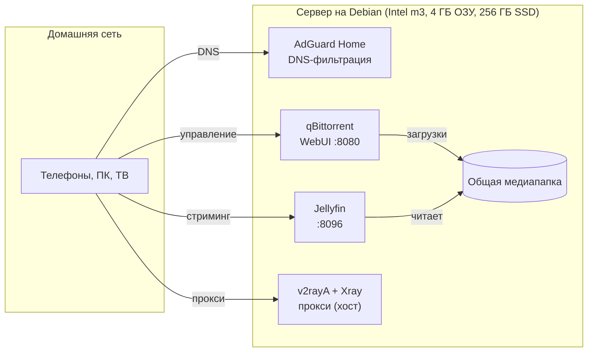

# Домашний сервер на старом ноутбуке

[English](README.md) · **Русский**

> Тихий безвентиляторный сервер на Debian из ноутбука с мёртвой батареей: DNS-блокировка рекламы, медиатека и загрузчик, всё в Docker Compose на 4 ГБ ОЗУ.

📺 **Видео:** [English](https://youtu.be/I3JlJ0OKSJ8) · [Русский (англ. субтитры)](https://youtu.be/SwqW1GDu1iw)
💼 **Разборы:** [LinkedIn](https://www.linkedin.com/in/aloncie/)

## Что внутри

| Сервис | Папка | Образ / источник | Порты | Что делает |
| --- | --- | --- | --- | --- |
| AdGuard Home | `net/` | `adguard/adguardhome` | host network (DNS 53; мастер настройки на 3000) | DNS-фильтрация, блокировка рекламы и трекеров, журнал запросов для всей сети |
| Jellyfin | `jellyfin/` | `lscr.io/linuxserver/jellyfin` | 8096 | Медиасервер с аппаратным транскодингом через `/dev/dri` |
| qBittorrent | `qbittorrent/` | `lscr.io/linuxserver/qbittorrent` | 8080 (WebUI, только LAN) + торрент-порт из `.env` | Загрузчик, пишет в общую медиапапку |
| v2rayA + Xray | `setup.sh` | пакеты apt | веб-интерфейс (по умолчанию 2017) | Прокси-маршрутизация для устройств в локальной сети, работает на хосте, не в Docker |

## Железо

| Компонент | Характеристики |
| --- | --- |
| Машина | Xiaomi Mi Notebook Air 12.5" (батарея мертва, без вентилятора) |
| CPU | Intel Core m3-7Y30 |
| ОЗУ | 4 ГБ |
| Диск | 256 ГБ SATA SSD |
| ОС | Debian 13, headless (без графической оболочки) |

## Архитектура



## Структура репозитория

```text
.
├── setup.sh                  # базовая настройка: обновления, тюнинг ядра, Docker, v2rayA + Xray
├── net/
│   └── docker-compose.yml    # AdGuard Home (host network)
├── jellyfin/
│   └── docker-compose.yml    # Jellyfin с пробросом /dev/dri
├── qbittorrent/
│   ├── docker-compose.yml    # qBittorrent
│   └── .env.example          # шаблон торрент-порта
└── .gitignore                # не пускает в git конфиги, базы, логи и .env
```

## Быстрый старт

1. **Установите Debian** (можно без графики) и включите SSH.
2. **Склонируйте репозиторий** и запустите базовую настройку:

```bash
git clone https://github.com/Aloncie/Server.git
cd Server
chmod +x setup.sh && ./setup.sh
```

Скрипт обновляет систему, по желанию ставит Zsh, Neovim, tmux и htop, включает BBR и IP forwarding, устанавливает Docker Engine с плагином Compose из официального репозитория, а также ставит и включает v2rayA с Xray. После этого перелогиньтесь, чтобы применилась группа docker.
3. **Поправьте пути** под свою машину (см. заметки ниже).
4. **Запустите стеки**, сначала DNS:

```bash
cd net && docker compose up -d && cd ..
cd jellyfin && docker compose up -d && cd ..
cd qbittorrent && cp .env.example .env   # сначала задайте TORRENT_INPUT_PORT
docker compose up -d
```
5. **Первый запуск:** откройте AdGuard Home на порту 3000 и завершите настройку, затем укажите DNS сервера в роутере. У Jellyfin свой мастер на 8096. Временный пароль qBittorrent печатается в `docker logs qbittorrent`.

## Заметки по настройке

- **Медиапапка:** в compose-файлах смонтирован `/home/aloncie-server/media`. Замените на свой путь в `jellyfin/docker-compose.yml` и `qbittorrent/docker-compose.yml`.
- **GPU-транскодинг:** Jellyfin использует `/dev/dri` и группу `render` (здесь GID `992`). Свой GID: `getent group render`.
- **WebUI qBittorrent** опубликован на LAN-адресе (`192.168.3.13:8080`). Замените его на IP своего сервера.
- **Часовой пояс** `Europe/Moscow` задан во всех compose-файлах.
- **Секреты остаются локально.** `.gitignore` исключает конфиги, базы, логи и `.env` файлы AdGuard, Jellyfin и qBittorrent. В репозитории лежит только `.env.example`.

## Чему учит безвентиляторный ноутбук на 4 ГБ

- **Потолок это ОЗУ.** С несколькими контейнерами на 4 ГБ следите за потреблением в простое, иначе решать будет OOM killer.
- **Ноутбук не любит быть сервером.** Заставьте крышку, файрвол и батарею вести себя как у сервера: см. [Защита сервера](#защита-сервера).
- **Пассивное охлаждение имеет предел.** При долгой нагрузке на диск будет троттлинг, следите за governor процессора и температурой.

## Защита сервера

Сервер, который работает 24/7, должен показывать наружу как можно меньше. На ноутбуке важнее всего три вещи: файрвол, крышка и батарея.

### Файрвол: закройте все порты, которые не используете

Политика по умолчанию: запретить весь входящий трафик, затем открыть только то, что нужно сервисам выше, и только для локальной сети. Каждый открытый порт это дверь, в которую можно стучаться, а закрытый порт атаковать нельзя.

| Порт | Сервис | Зачем открыт | Кому доступен |
| --- | --- | --- | --- |
| 22/tcp | SSH | Удалённое администрирование машины без экрана | Только LAN (вход по ключу, без root и паролей) |
| 53/tcp+udp | AdGuard Home | DNS для всей сети, ради этого сервер и нужен | Только LAN |
| 3000/tcp | AdGuard Home | Мастер первой настройки | Открыт только на время настройки, потом закройте |
| 80/tcp | AdGuard Home | Веб-интерфейс после мастера | Только LAN |
| 8096/tcp | Jellyfin | Стриминг на ТВ, телефоны и ПК | Только LAN |
| 8080/tcp | qBittorrent | WebUI | Только LAN |
| торрент-порт (из `.env`) | qBittorrent | Входящие соединения; без него загрузка медленнее | Единственный порт, который можно пробросить на роутере, и только если это нужно |
| 2017/tcp | v2rayA | Веб-интерфейс | Только LAN |
| 20170-20172/tcp | v2rayA | Прокси-порты по умолчанию для устройств в сети | Только LAN, и только если другие устройства ходят через прокси |

Всё остальное остаётся закрытым. Порты 3000 и 80 зависят от того, как вы завершили мастер AdGuard, поэтому сначала проверьте, что реально слушает порты: `sudo ss -tulpn`, и поправьте таблицу под свою установку.

```bash
sudo apt install ufw
sudo ufw default deny incoming
sudo ufw default allow outgoing

# замените подсеть на свою
sudo ufw allow from 192.168.3.0/24 to any port 22 proto tcp
sudo ufw allow from 192.168.3.0/24 to any port 53
sudo ufw allow from 192.168.3.0/24 to any port 80 proto tcp
sudo ufw allow from 192.168.3.0/24 to any port 8096 proto tcp
sudo ufw allow from 192.168.3.0/24 to any port 8080 proto tcp
sudo ufw allow from 192.168.3.0/24 to any port 2017 proto tcp

sudo ufw enable
sudo ufw status numbered
```

Две вещи, которые важно знать:

- **Docker обходит ufw.** Docker сам пишет правила iptables, поэтому порт, опубликованный через `ports:`, может быть доступен, даже если ufw считает его закрытым. Поэтому qBittorrent опубликован только на LAN-адресе. Для Jellyfin либо привяжите порт к LAN IP (`192.168.3.13:8096:8096`), либо фильтруйте в цепочке `DOCKER-USER`. AdGuard работает в host network, поэтому ufw на него действует как обычно.
- **Не пробрасывайте порты на роутере**, кроме, при желании, торрент-порта. Для доступа извне используйте VPN, а не открытые в интернет WebUI.

Ещё усильте SSH в `/etc/ssh/sshd_config`: `PasswordAuthentication no`, `PermitRootLogin no`, затем `sudo systemctl reload ssh`. Сначала скопируйте свой ключ через `ssh-copy-id`.

### Чтобы сервер работал с закрытой крышкой

По умолчанию systemd-logind усыпляет ноутбук при закрытии крышки, и сервер превращается в кирпич. Отредактируйте `/etc/systemd/logind.conf`:

```ini
HandleLidSwitch=ignore
HandleLidSwitchExternalPower=ignore
HandleLidSwitchDocked=ignore
```

Затем перезагрузитесь (или выполните `sudo systemctl restart systemd-logind`, но это может оборвать SSH-сессию). Экран может оставаться выключенным: Debian без графики он не нужен.

### Забота о батарее

Сервер из видео работает без живой батареи, но если у вас она есть, то ноутбук, который год стоит на зарядке на 100%, быстро её убивает, а вздувшийся элемент это риск пожара. Держите заряд примерно между 20% и 80%:

- Многие ноутбуки дают лимит в прошивке или BIOS («battery care», «conservation mode»).
- В Linux проверьте `ls /sys/class/power_supply/BAT0/` на наличие `charge_control_end_threshold`. Если файл есть, запишите в него `80` (чтобы сохранялось после перезагрузки, используйте systemd-юнит или TLP).
- С TLP (ThinkPad и некоторые другие модели): задайте `START_CHARGE_THRESH_BAT0=20` и `STOP_CHARGE_THRESH_BAT0=80` в `/etc/tlp.conf`.

Поддержка зависит от производителя. Если на вашей модели ничего из этого нет, самое безопасное для сервера, который всегда включён в розетку: вынуть мёртвую или вздувшуюся батарею и работать от сети, как в этом проекте.

## Безопасность и законность

- Держите WebUI в локальной сети, а файрвол закрытым по умолчанию (см. выше). Не выставляйте AdGuard, Jellyfin и qBittorrent в интернет без reverse proxy и аутентификации.
- Контейнеры запускаются от обычного пользователя (`PUID/PGID 1000`), где образ это поддерживает.
- Используйте qBittorrent только для контента, которым вы вправе делиться, например образы Linux и открытые медиа.

## Автор

**Богдан Бакута (Aloncie)** · Разработчик системного ПО · [GitHub](https://github.com/Aloncie) · [LinkedIn](https://www.linkedin.com/in/aloncie/) · [Telegram](https://t.me/Aloncie)
